# Dockmaster

**Self-hosted container orchestration for a handful of Linux hosts** — one dashboard, one small agent per
machine. Docker Compose projects, replicas, zero-downtime rolling updates, secrets, scheduled jobs, autoscaling,
a WireGuard mesh between servers, users with roles — without Swarm or Kubernetes.

It was built for a real setup: a NAS at home, a couple of VPS, a dozen compose projects, and one person who wanted
to click a button instead of `ssh`-ing into each box. If that is you, it may fit.

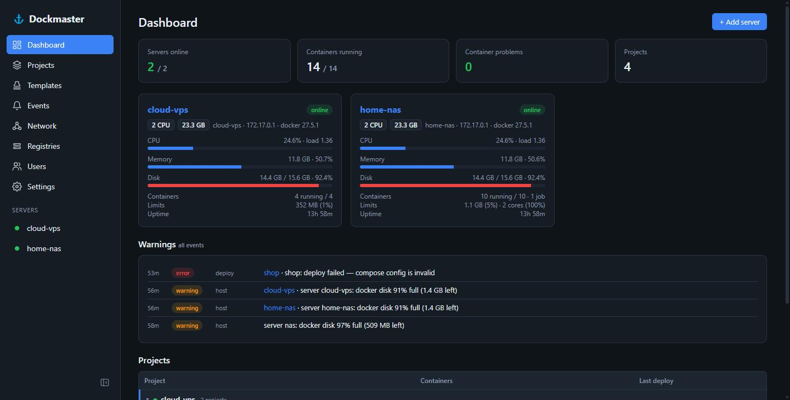

```
 ┌──────────────────── NAS (docker) ────────────────────┐
 │  dockmaster-server  :8080  UI (React) + REST + SignalR │
 │                     :9443  agents (gRPC/TLS, pinned)   │
 └──────────────────────────▲───────────────────────────┘
                            │ outbound only, one persistent stream per agent
           ┌────────────────┴────────────────┐
   ┌───────┴────────┐                ┌───────┴────────┐
   │   home-nas     │                │   cloud-vps    │
   │ dockmaster-    │  docker.sock   │ dockmaster-    │
   │ agent          │  + compose     │ agent          │
   └────────────────┘                └────────────────┘
```

* **Server**: one container (ASP.NET Core 9 + React 19, SQLite inside). Runs on the NAS or any docker host.
* **Agent**: one container per server. It only connects *out* to the server over TLS, pins the server's certificate
  and has its own token. Nothing has to be opened on the servers, no SSH, no public API on the agents.
* **Projects are plain `docker-compose.yml` + `.env`.** Dockmaster writes into your file only what you changed in a
  form, and keeps your comments. You can always take the file and run it with `docker compose` yourself.

## Quick start

```bash
# 1. the server (NAS or any docker host)
curl -fsSLO https://raw.githubusercontent.com/Anton4ik/Dockmaster/main/deploy/docker-compose.yml
docker compose up -d
docker logs dockmaster        # prints the one-time setup code
```

Open `http://<host>:8080`, enter the setup code, choose the admin's name and password.

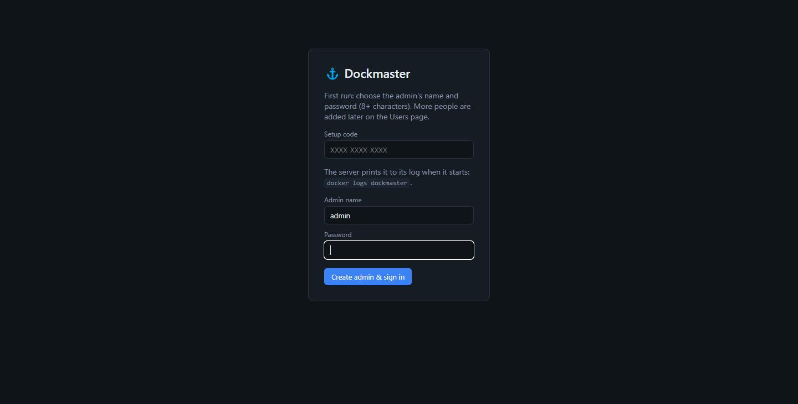

Then **Add server**: the page prints a `docker run` for the agent (token and certificate fingerprint included).
Paste it on every machine you want to manage — that is all. Put a reverse proxy with TLS in front of port 8080;
leave port 9443 alone (the agents pin its certificate).

Images: `ghcr.io/anton4ik/dockmaster-server` and `ghcr.io/anton4ik/dockmaster-agent` (linux/amd64, built by
GitHub Actions from `main`). Building them yourself: `docker build -f src/Dockmaster.Server/Dockerfile .` and the same
for the agent; see [docs/reference.md](docs/reference.md) for every setting.

---

## The tour

Everything below was recorded on a demo installation with made-up projects (`shop`, `blog`, `wiki`) on two servers,
`home-nas` and `cloud-vps`.

### 1. A project in a minute

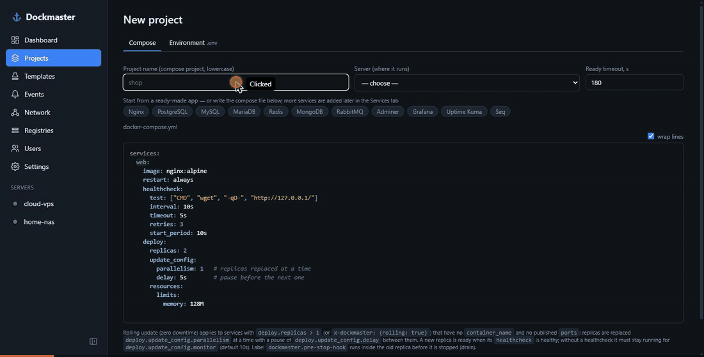

**What it does.** *Projects → New*: a name, the server it runs on, and either a compose file you paste or one click on a
ready-made app (Nginx, PostgreSQL, MySQL, MariaDB, Redis, MongoDB, RabbitMQ, Adminer, Grafana, Uptime Kuma, Seq). The
app comes with made-up passwords and a volume for its data. **Pull & deploy** pulls the images and starts everything;
the log streams live into the page.

**Why.** Starting an app on a server used to mean: ssh, mkdir, write a compose file from memory, remember the volume,
`docker compose up`, check the logs. Now someone who has never written YAML can start PostgreSQL with a volume in
three clicks, and someone who has can paste their file and keep it exactly as it is.

### 2. Services: replicas, limits and rolling updates

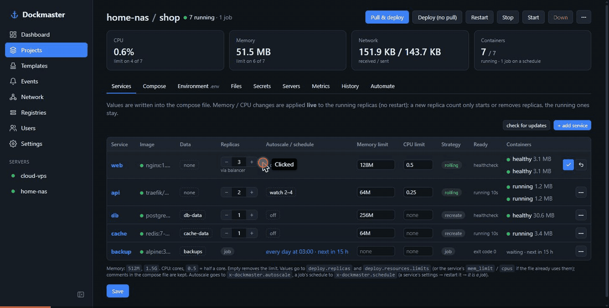

**What it does.** The *Services* tab is a table of the project's services with their image, data, replica count,
memory and CPU limits, update strategy, readiness rule and containers. Replicas and limits are editable in place:
memory and CPU changes are applied **live** to the running containers (`docker update`, no restart); a new replica
count starts or drains replicas without touching the ones that run. A service with `deploy.replicas > 1` and no fixed
`container_name` gets a **rolling update**: new replica starts → waits until its healthcheck is green → an optional
drain hook runs in the old one → old one stops → next. If the new replica never gets healthy, it is removed and the old
ones keep running.

**Why.** This is the one thing Compose does not give you and the reason people reach for Swarm or Kubernetes: an
update without a second of downtime and with an automatic way back. Here it is one button, and the rules
(`parallelism`, `delay`, drain hook, ready timeout) are ordinary compose keys, so the file stays portable.

**Several replicas behind one port.** Only one container can hold `8080:80`. When you give such a service more
replicas, Dockmaster offers a **balancer** (a small HAProxy container holds the port and spreads connections over the
replicas it finds in docker's DNS — also the ones a rolling update or the autoscaler adds) or a **port range**
(`8080-8081:80`, one port per replica).

### 3. Service settings as a form

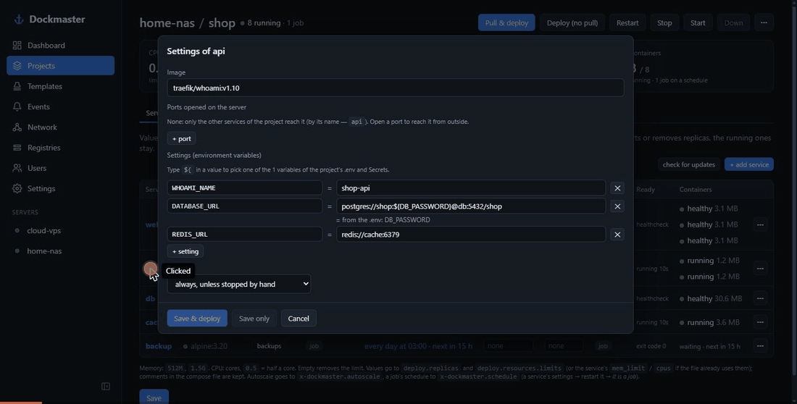

**What it does.** Click a service's name: the image, the ports opened on the server, the environment settings
(with `${VARIABLES}` from the `.env` and secrets offered in a picker), and when docker restarts it. **Save & deploy**
re-creates only that service (rolling, when it qualifies). *+ add service* starts from a ready-made app or any image.

**Why.** Editing `environment:` by hand is where typos happen. The form shows what each variable means, offers the
project's variables, and writes only what you changed back into the YAML — comments and ordering survive.

### 4. Data: volumes and folders, with warnings

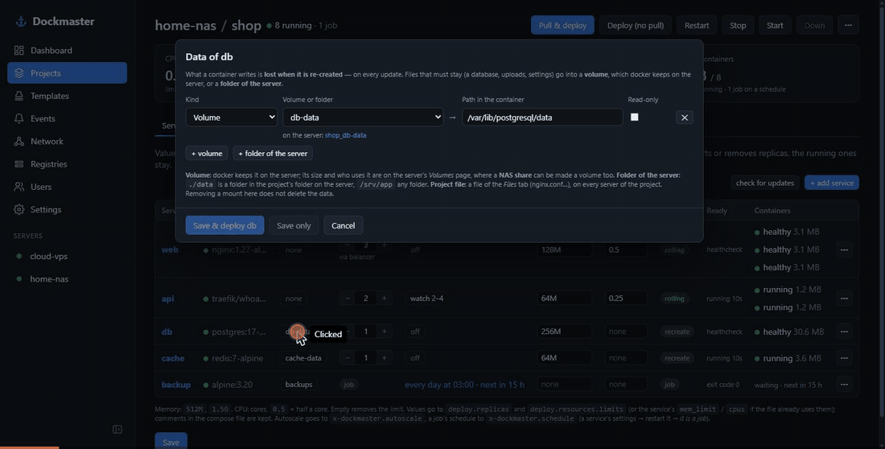

**What it does.** *Services → Data* shows where a service keeps the files that must survive an update: a docker
**volume** (new, one the project already has, or any volume of the server) or a **folder of the server**, at a path in
the container, read-only or not. The paths the image keeps its data in are offered (read from the image, or known for
postgres, mysql, redis…). A service whose image writes data to a path nothing keeps is flagged: *it is lost on the next
update*.

**Why.** The most common self-hosting accident is a database without a volume. Dockmaster says so before the deploy,
and also when data would stay behind: a service moved to another server starts empty there, an unnamed volume is
easily lost, a rolling update of a single replica would run two containers on the same database.

### 5. Secrets

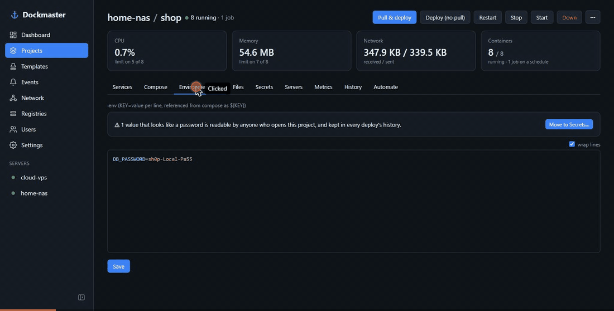

**What it does.** The *Environment* tab (the `.env`) notices values that look like passwords, keys and connection
strings and offers to **move them to Secrets** in one go. A secret is write-only, stored encrypted on the server, and
reaches the service either as a `${VARIABLE}` (filled in on deploy, like a `.env` line) or as a file in
`/run/secrets/<name>` (tick the services that read it). Users without the *Secrets* permission see `(hidden)` instead of
values — in the `.env`, in the compose file and on the container page.

**Why.** Passwords in a `.env` are readable by everyone who opens the project and are kept in every deploy's history.
Secrets are not — and apps that read their settings from the environment need no change at all.

### 6. Config files in the browser

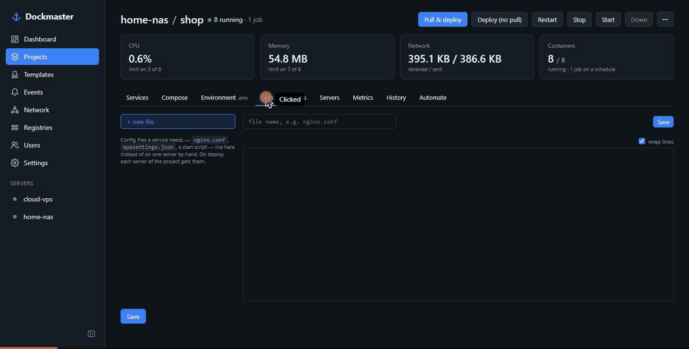

**What it does.** The *Files* tab holds the project's config files — `nginx.conf`, `appsettings.json`, a start
script — edited in the browser with the file's syntax. Every deploy writes them to each server of the project; a
service mounts one at a path in its container. A changed file re-creates the services that mount it on the next deploy
(its hash goes into a label), an unchanged one does not.

**Why.** No more `scp nginx.conf` to three servers and wondering which one has the newer copy. The file lives with
the project, in its history, in its backup.

### 7. History, diff and rollback

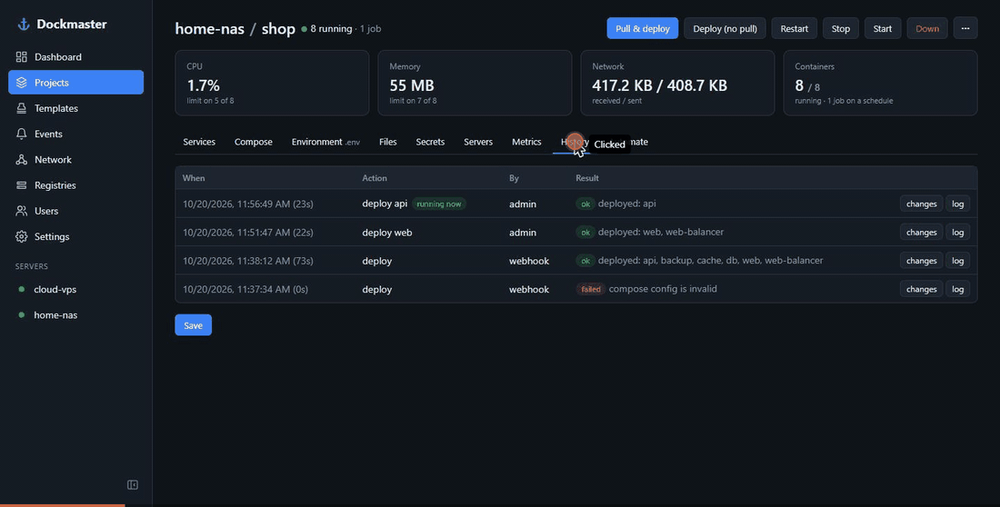

**What it does.** Every deployment is kept with its full log and the exact compose file and `.env` it put out.
**changes** shows what changed since then (red gone, green new) and **go back to this version** redeploys those
files. A save from a page that loaded the project before someone else changed it is refused instead of running
over their change.

**Why.** "What did I change before it broke?" has an answer, and "put it back" is one click.

### 8. Jobs on a schedule

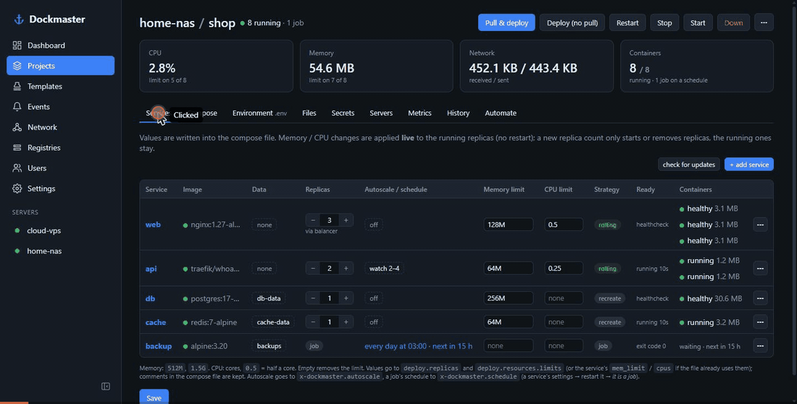

**What it does.** A service with a schedule (*it is a job* in its settings: every N minutes or hours, every day,
Mon–Fri, some days, a day of the month, or a cron line; in the time zone you pick) is created by the deploy but not
started. Dockmaster starts it at its time; it does its work and exits, and that is not an error. The job's row shows
the schedule in words and the next run; *runs & schedule* lists the last runs with how long each took, how it ended and
who started it. A run still going when the next time comes is skipped, never doubled. A failed run is a warning under
*Events*, with the container's last log lines.

**Why.** Backups, reports and clean-ups do not belong in `crontab` on each server, where nobody sees whether they
still run. This is a CronJob the way Kubernetes has it, for a compose project.

### 9. Autoscaling — first in recommend mode

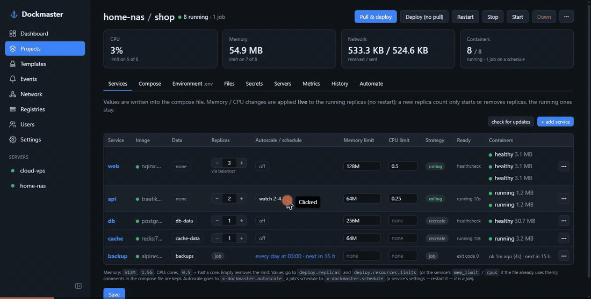

**What it does.** A service may run more replicas while the ones it has are busy: *the least* and *the most* replicas,
a CPU threshold (against the service's CPU limit), and the servers extra replicas may go to. In **recommend** mode
nothing changes: Dockmaster reports under *Events* what it would have done and when — run it for a few weeks and see
whether autoscaling would help at all. In **auto** mode it does it: one more replica after 3 minutes above the
threshold, one less after 15 minutes in which the rest would stay below ¾ of it, placed on a server that is online, not
busy and has the memory for it — and reached through the balancers, so nothing else has to change.

**Why.** Autoscaling you cannot see is autoscaling you do not trust. Recommend mode shows the decisions before they
cost anything.

### 10. Every server at a glance

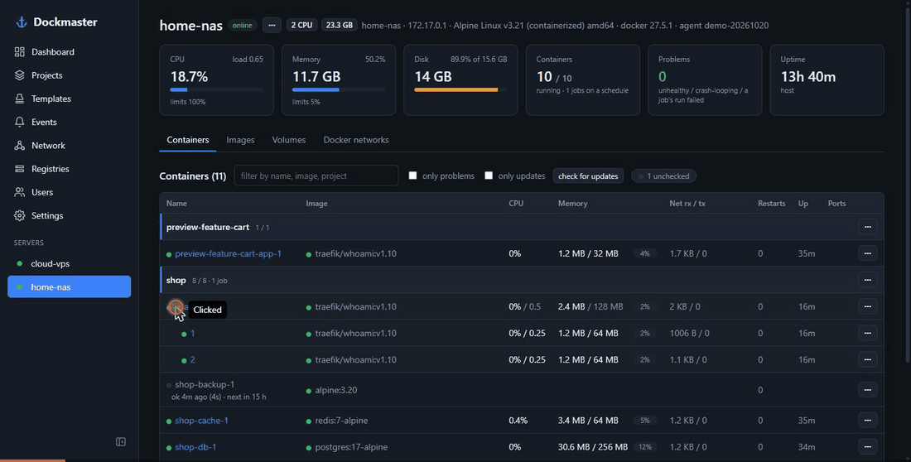

**What it does.** A server's page: host CPU, memory, disk and load; every container with its project, image status
(*latest*, *update available*), CPU, memory against its limit, network, restarts and uptime, refreshed as the agent
reports (every 5 s while you look). Replicas fold under their service. The menu of a container: live logs (with level
filter, pretty or raw), memory and CPU limits changed on the fly, pull & redeploy, restart, stop, kill. Containers
started outside Dockmaster are listed too and can be **imported**: the agent reads the compose file named in their
labels (Portainer stacks included) and takes the project over on the next deploy.

**Why.** It replaces `docker ps`, `docker stats`, `docker logs -f` and `htop` on every box with one page, and the agent
costs about one stats call per container per report, so a quiet host is cheap to watch.

### 11. A shell in any container

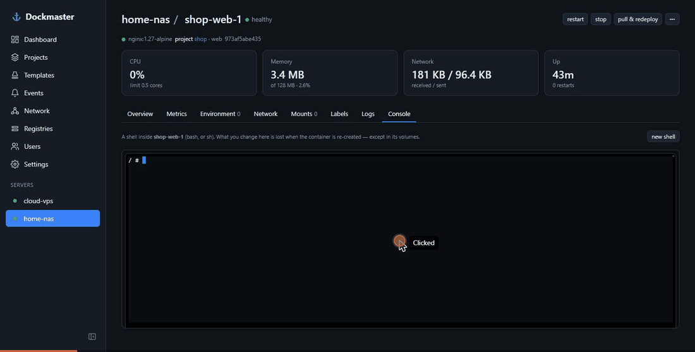

**What it does.** A container's page: overview, environment (values hidden without the permission), network, mounts,
labels, logs, 24-hour metrics (CPU against the limit, memory with the minute's *peak* — the spike the OOM killer acts
on — and traffic), and a **console**: a shell inside the running container in the browser, with colours and the window's
size.

**Why.** `docker exec -it` without ssh, without knowing which server the container landed on, and only for users with
the *Terminal* permission.

### 12. Volumes, images, networks

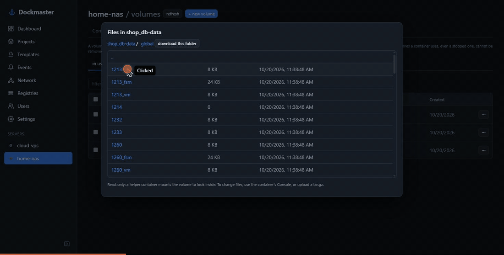

**What it does.** Every volume of a server with its size, the containers that use it and the project it belongs to;
unused and unnamed ones apart. **Browse** its files folder by folder, **download** it as a `.tar.gz`, **upload** one
into it, or **copy it to another server** — packed there, sent through the Dockmaster server, unpacked on the other
one — for a service that moves with its data. New volumes can be a folder of a NAS over **NFS** or **SMB**. The
*Images* page lists every image with the containers using it, and removes untagged leftovers and unused ones in one
click (every pull & deploy already removes the image it replaced). *Docker networks* shows which containers share a
network and makes new internal networks for services of different projects to reach each other.

**Why.** Disk fills up with old images; a database has to move to the new server; a volume has to be looked into
without a helper container you write by hand. All of that is a menu.

### 13. Network between servers (WireGuard mesh)

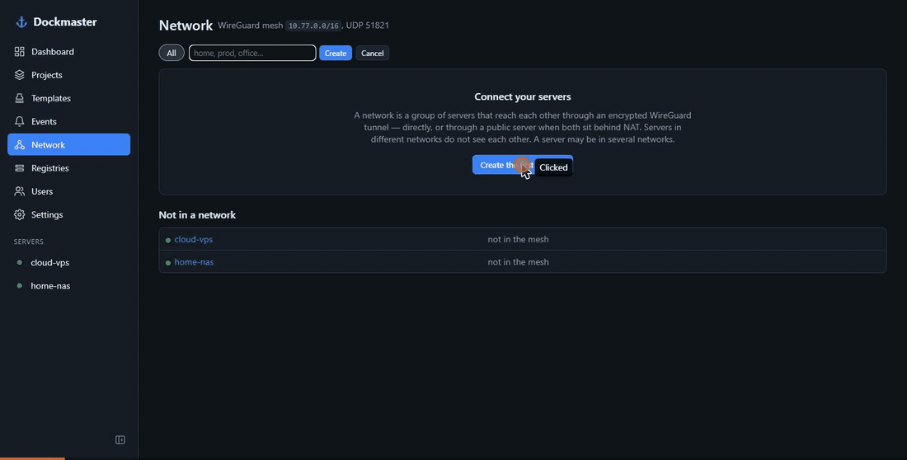

**What it does.** The *Network* page puts servers into a **WireGuard mesh** the server manages: the agent starts a
small sidecar that owns a `dm0` interface on the host, keys are generated on the host and only the public key leaves
it. Who talks to whom is decided from the addresses, no probing: a server with a public address is a direct peer for
everyone; two servers behind the same NAT talk over the LAN; two behind different NATs go through a public **hub**;
nothing has to be forwarded on a router as long as one server is public. The page shows the path of every pair, a live
ping matrix, an iperf3 benchmark per pair, and **Tune speed** measures the MTU of each path. A project may then spread
its services over servers: the compose file says where each service runs, and the services reach each other through
the mesh as if on one host.

**Why.** A database on the NAS and the web app on a VPS used to need a VPN set up by hand on both ends and a firewall
rule per port. Here it is a checkbox per server, and the containers do not know the difference.

### 14. Users and roles

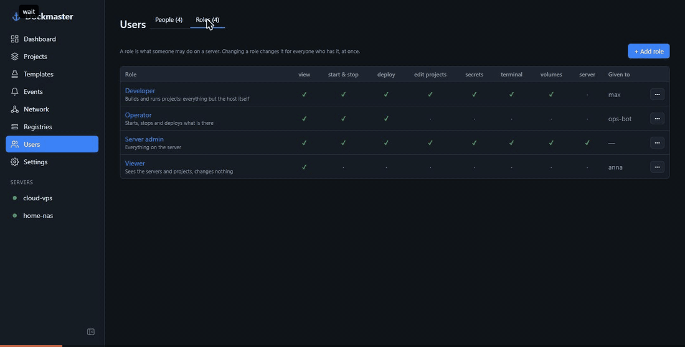

**What it does.** Everyone signs in with a name and a password. An **admin** may do everything. Anyone else sees only
the servers they were given a **role** on, and does there what the role allows. A role is a set of permissions —
*View*, *Start & stop*, *Deploy*, *Edit projects*, *Secrets*, *Terminal*, *Volumes*, *Server* — shown as a table;
new installations start with Viewer, Operator, Developer and Server admin, all editable. The server checks every
request and every live call; the UI only leaves out what would be refused. A changed role applies at once; a disabled
account ends its sessions.

**Why.** A developer can deploy their project on the staging server and not see the production database's password,
and the person on call can restart things without being able to change them.

### 15. Templates and an API for programs

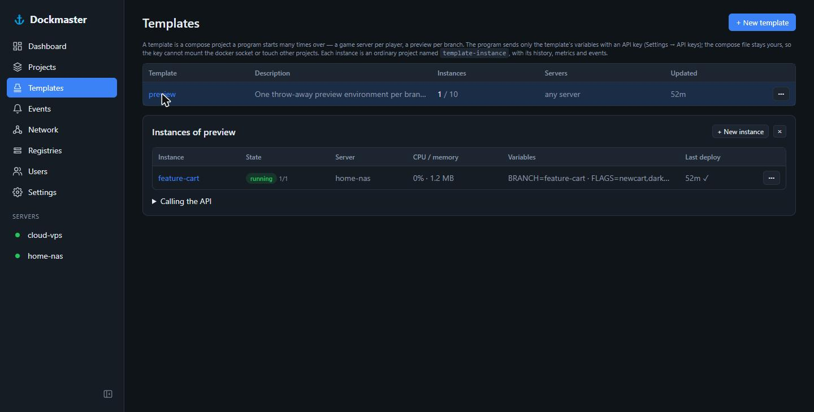

**What it does.** A **template** is a compose project a program starts many times over — a game server per player, a
preview environment per branch. It holds the compose file, the **variables** a caller may set (required, default,
pattern), the servers instances may go to and the most instances at a time. An **API key** manages the instances of the
templates it lists — and nothing else: it never sends compose of its own, so it cannot mount the docker socket or reach
other projects. Values are written quoted into the instance's `.env`, so a value can never add keys, mounts or
services. Each instance is an ordinary project with its history, metrics and events.

```
Authorization: Bearer dmk_…
POST   /api/templates/preview/instances   {"name":"feature-cart","variables":{"BRANCH":"feature-cart"},"deploy":true}
GET    /api/templates/preview/instances/feature-cart   → state: running
DELETE /api/templates/preview/instances/feature-cart
```

**Why.** CI can create a preview per pull request with one `curl`, and the key it holds cannot do anything else
on your servers.

### 16. Deploy from CI with a webhook

**What it does.** The *Automate* tab gives each project a secret URL: `curl -fsS -X POST "<url>"` pulls and deploys.
`?services=api` deploys only that service, `&tag=1.4.2` first writes that tag into the service's image, `&wait=true`
answers when the deploy is over (500 when it failed, so the CI step fails). The tab has the ready step for Drone,
GitHub Actions and GitLab CI, and the history marks these deploys *webhook*.

**Why.** The last step of a pipeline becomes one line, and a bad deploy fails the pipeline instead of being
discovered the next morning.

### 17. Metrics, events, notifications

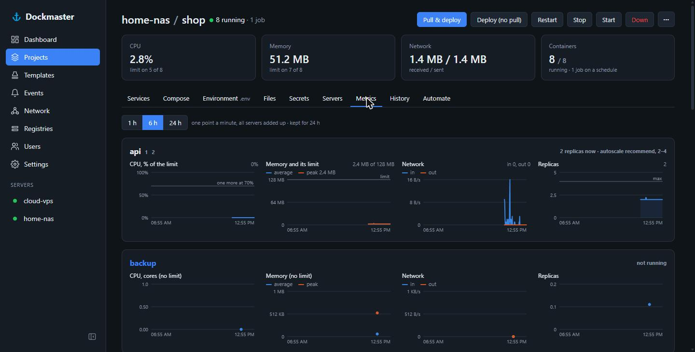

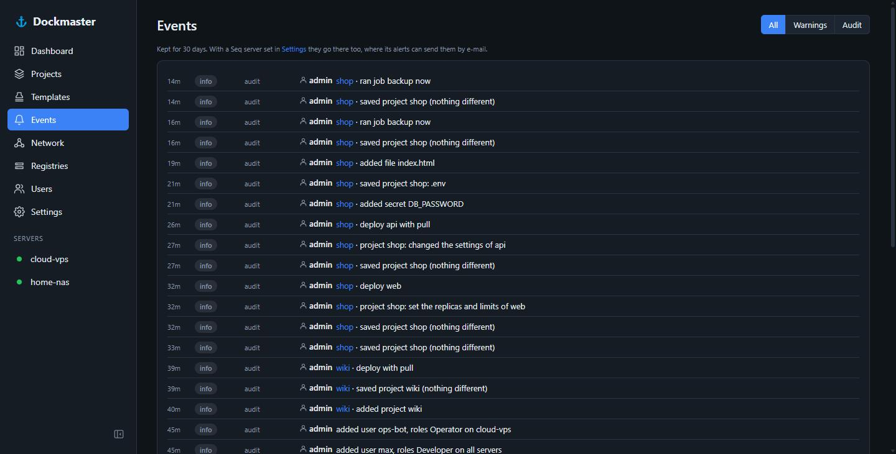

**What it does.** Every minute the server keeps a point of each server, each service (its replicas added up: CPU
against the limit, memory, traffic, replica count) and each container for 24 hours; the project's *Metrics* tab charts
them. **Events** reports what matters and when it is over: failed deploys; a server away for more than 2 minutes;
containers that restart, turn unhealthy, stop with an error or are killed for running out of memory (not while their
project is being deployed on purpose); a host above 90 % memory or docker disk; a service above 90 % of its CPU or
memory limit for a while; a replica whose lowest memory of the day keeps rising day after day — most likely a leak;
what the autoscaler does or would do; every failed job run. Every action of every user is in the audit list. With a
**Seq** address in *Settings* every event goes there too, and Seq's alerts send the e-mails — events wait in the
database while Seq is unreachable.

**Why.** Instead of a monitoring stack you install next to the orchestrator, the orchestrator already knows when a
container restarts or a deploy fails, and tells you.

### 18. Private registries

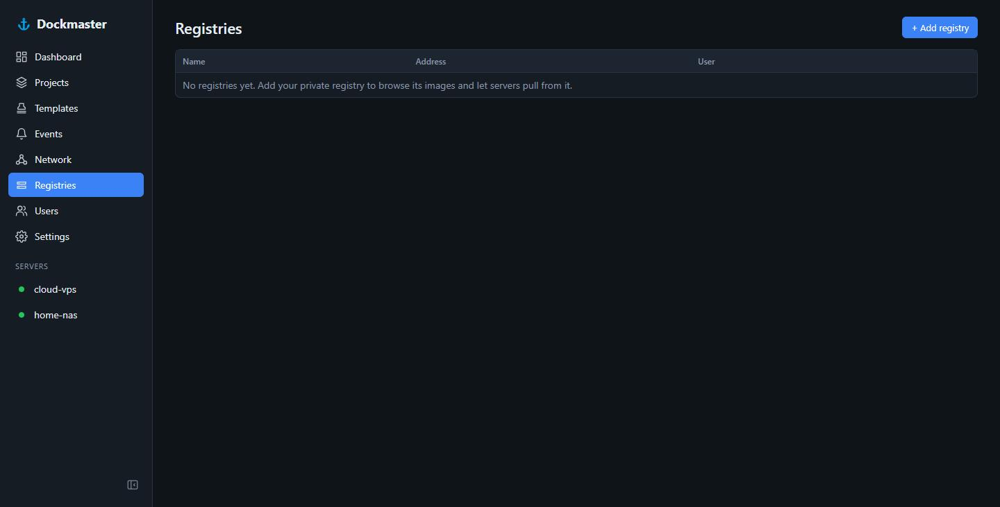

**What it does.** Private registries (basic or bearer auth, stored encrypted). The UI browses their repositories and
tags, the image-status column on every page asks them for newer tags, and an agent receives credentials only for the
registries a project's images actually reference, only at deploy time.

### 19. Settings, backup, restore

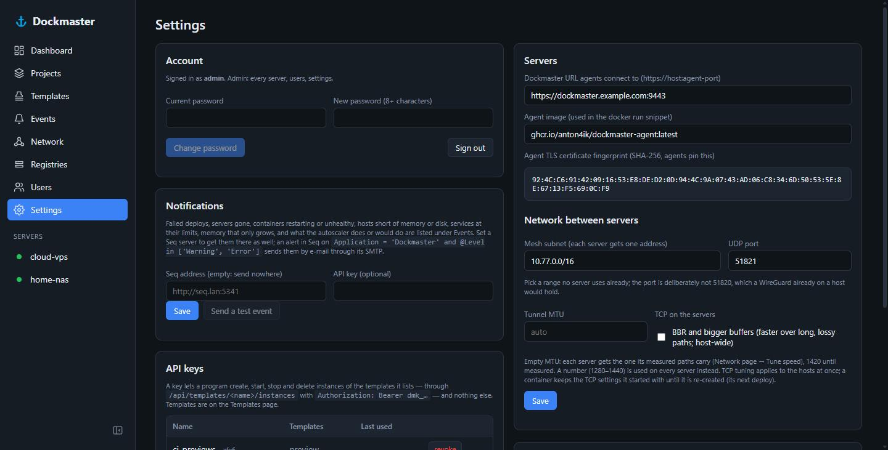

**What it does.** The agents' URL and image, the certificate fingerprint they pin, the mesh subnet and port, Seq for
notifications, API keys, and **Backup**: one a day (the last 7 kept), a download on demand, and restore from a file —
the database with every project, file, secret and history, the agents' certificate and the keys that decrypt the
secrets. Restore an installation on a new NAS and every agent reconnects as before.

### 20. Works on a phone

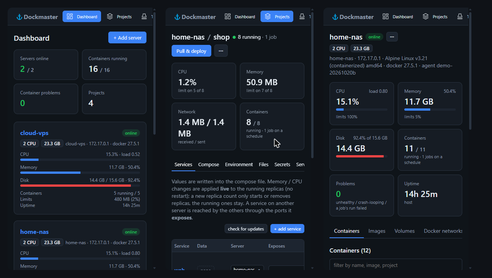

Every page is laid out for a phone, a tablet and a wide monitor: the dashboard and a project's services are usable
from the sofa when something restarts at night.

---

## How it is built

| Path | What |
| --- | --- |
| `src/Dockmaster.Server` | ASP.NET Core 9: REST API, SignalR hub for the live view, gRPC hub for the agents, SQLite (EF Core), registry client, the planner, the autoscaler, the job scheduler, the mesh planner |
| `src/Dockmaster.Web` | React 19 + Vite + TypeScript UI, built into the server image |
| `src/Dockmaster.Agent` | .NET 9 worker: Docker Engine API + `docker compose`, rollout logic, volume tools, the mesh sidecar, self-update |
| `src/Dockmaster.Shared` | protobuf contract between agent and server |
| `tests/Dockmaster.Tests` | ~970 unit tests (planner, compose editing, access, mesh, API) |
| `tests/Dockmaster.IntegrationTests` | the agent against a real Docker engine (`DOCKMASTER_IT=1`) |
| `deploy/docker-compose.yml` | the server |

```bash
dotnet test tests/Dockmaster.Tests            # unit tests
cd src/Dockmaster.Web && npm ci && npm run build   # the UI (into the server's wwwroot)
dotnet run --project src/Dockmaster.Server    # http://localhost:8080
```

The agent is Linux-only (it needs docker.sock); the server runs anywhere .NET runs. CI (`.github/workflows/build.yml`)
runs the tests and pushes both images to GHCR on every push to `main`.

[docs/reference.md](docs/reference.md) has the full description of every page, compose key, environment variable
and API endpoint.

## Status

Dockmaster runs the author's own servers every day, and the features above are the ones that came out of that. It is
a one-person project published because it may save someone else the same year of evenings. Issues and pull requests
are welcome; so is a note saying what you run it on.

## Support the project

If Dockmaster saved you a weekend, you can buy the author a coffee:

**[Donate with PayPal](https://www.paypal.com/donate/?business=anton4ik%40inbox.lv&currency_code=EUR)** —
`anton4ik@inbox.lv`

## License

[MIT](LICENSE) — © 2026 Anton Temerbekov.
